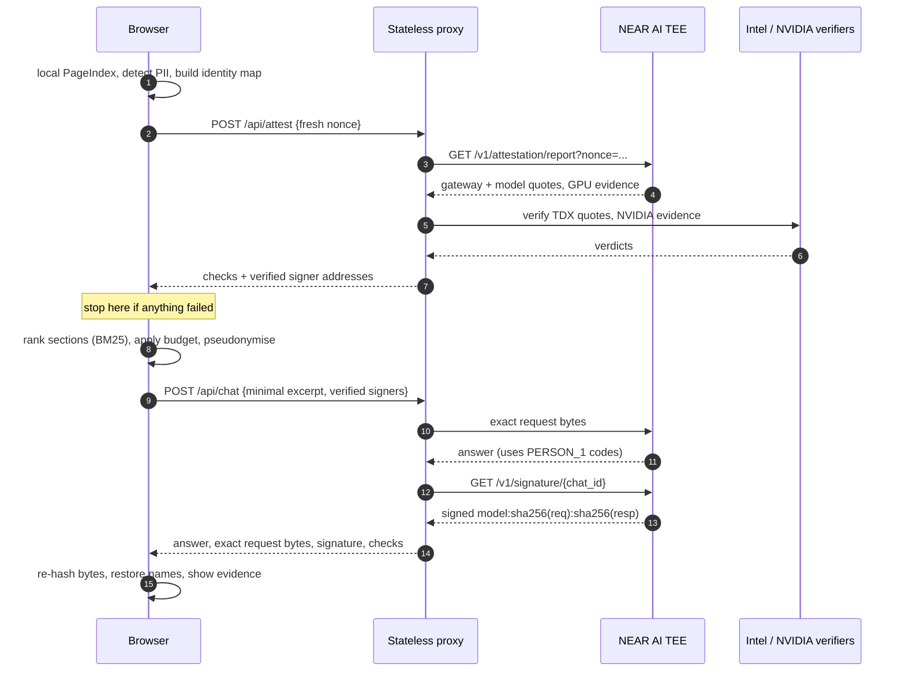

# Need-to-Know

**Ask AI about a confidential document, and send it only what it needs.**

> The TEE proves *where* your document was processed. Need-to-Know proves *how little* of it was sent.

Built at the NEAR Hackathon for the **Privacy & Private AI** track. Inference runs on **NEAR AI Cloud** inside Intel TDX and NVIDIA confidential-computing enclaves. Every question starts with a fresh-nonce attestation, and every answer is tied to a verified enclave by its signature. Documents are indexed, minimised and pseudonymised in your browser, and a NEAR wallet unlocks an encrypted private library that never leaves your machine.

**Contents:** [Why](#why) · [User flow](#user-flow) · [Architecture](#architecture) · [How it works](#how-it-works) · [What is verified](#what-is-verified) · [What the server keeps: nothing](#what-the-server-keeps-nothing) · [Benchmark](#benchmark-does-privacy-cost-accuracy) · [Quick start](#quick-start) · [End-to-end test flow](#end-to-end-test-flow) · [Repository map](#repository-map) · [Threat model and limits](#threat-model-and-honest-limits) · [Disclosures](#disclosures) · [License](#license)

---

## Why

AI tools send far more of a confidential document to the model than a question needs. Long-context chat pastes everything; typical RAG sends several large raw chunks. A TEE keeps the operator and host from reading data while it is processed, but it cannot protect against a bug in the software running *inside* it, and it does nothing about *how much* you send.

That risk is real. On **9 November 2026**, NEAR AI paused cloud inference after an attacker exploited a remote-code-execution flaw in **SGLang**, the open-source inference engine running on its servers. Reports put the exposure at roughly 100 users. NEAR AI's own explanation draws the line: confidential computing protects data from the operator and host, not from a vulnerability in the software running inside the enclave. Service was restored around 10 November. ([Crypto Briefing](https://cryptobriefing.com/near-ai-pauses-cloud-inference-unauthorized-access/), [Let's Data Science](https://letsdatascience.com/news/sglang-flaw-lets-attacker-breach-near-ai-inference-servers-fa6fb270), [Glitchwire](https://glitchwire.com/news/near-ai-halts-cloud-inference-after-unauthorized-access-to-internal-systems/))

Need-to-Know adds a second layer and **assumes the enclave can be breached**:

| Layer | Question it answers | Provided by |
|---|---|---|
| TEE and attestation | Was my data processed somewhere genuine and sealed? | NEAR AI Cloud |
| Data minimisation | How much of my data was there to steal? | Need-to-Know, in your browser |
| Proof | Exactly which bytes left, signed by the enclave and by me? | Exposure receipt (enclave + NEAR wallet) |

Had a session like this been running during the November 9 incident, an attacker would have got only the Breach Replay view: a few pseudonymised sections, no names, no IDs, no real dates.

---

## User flow

1. **Open the app.** Optionally tick **Use my own NEAR AI key** and paste a key. It is stored only in your browser.
2. **Pick a document.** Choose a fictional sample, or upload your own **PDF, Markdown or text** file. It is read and indexed in the browser: you see "Local index: N sections, from PDF outline / typography, built in 3 ms, 0 bytes sent". Click **Your view** to see every identifier the app found.
3. **Optional: connect a NEAR wallet** (Meteor or MyNearWallet) and **unlock your private vault** with one signature. Save the document to the vault: it is encrypted with a key derived from your wallet signature and stored in this browser only.
4. **Ask a question,** or click a preset. The app verifies the enclave first, chooses the few relevant sections locally, replaces identifiers with codes, sends that sliver, and restores names in the answer.
5. **Read the evidence:**
   - **Answer** with restored names (dashed underline). "Show what the enclave actually answered" reveals the coded version.
   - **What the enclave saw:** the document as a redaction map.
   - **Exposure Meter:** your exposure compared with pasting the document and with typical RAG.
   - **Verified** panel: every attestation and signature check.
6. **Breach Replay:** the attacker's view under each approach, plus the exact request bytes. Your browser re-hashes them and finds the hash inside the enclave's signature.
7. **Optional: co-sign the receipt** with your NEAR wallet and download it as JSON. It holds hashes only and can be verified offline.
8. **Come back later:** unlock the vault, reopen the document, and see your earlier questions and answers (also encrypted).

If relevant sections did not fit your exposure budget, the app names them and offers **Allow N% and re-ask**, so the privacy/accuracy trade-off is your visible choice.

---

## Architecture


Editable source: [`docs/architecture.excalidraw`](docs/architecture.excalidraw). Open it at [excalidraw.com](https://excalidraw.com) with **Open**, or in the Excalidraw VS Code extension.

### One question, in order



---

## How it works

### 1. Local PageIndex (no model, no network)
`web/src/lib/pdf.ts`, `web/src/lib/sectionize.ts`. PDFs are parsed with pdf.js in the browser. The table of contents comes from, in order: the **PDF outline** (bookmarks), else **typography** (lines larger than body text or bold at body size; numbering like `3.2.1` sets the depth), else **pages**. Running headers/footers and rotated margin text are dropped. Every section keeps its page number. Markdown and text files use their headings. PrivateRAG built its PageIndex tree by sending the whole document to an LLM; that would defeat need-to-know, so the tree is built locally.

### 2. Pseudonymisation
`web/src/lib/pii.ts`. Names, record numbers, phones, emails, addresses, organisations, accounts and card digits become consistent codes (`Maria Lopez` becomes `PERSON_1` everywhere). Names are found from labelled fields, titles, a first-name list, known surnames, and **email local parts** (`noam@` links to "Noam Shazeer"). Dates and month names shift together by a secret number of whole months, so intervals still work. Date of birth becomes its decade. Money amounts are kept. The code map stays in the browser.

### 3. Choosing sections
`web/src/lib/retrieval.ts`. **Local BM25** ranks sections, so nothing leaves the browser to make the choice. Vague questions ("audit my spending") that match no keywords fall back to sending only the **pseudonymised headings** to the TEE so the model can pick sections (PageIndex-style tree search, on a minimised tree).

### 4. Exposure budget
`web/src/lib/plan.ts`. The chosen sections are capped at your budget (10% by default). Strongly relevant sections that were cut are listed, with a one-click re-ask at a larger budget.

### 5. Attest before sending
`server/verify.py`. The browser makes a 32-byte nonce. The proxy verifies the gateway and every GPU enclave (see [What is verified](#what-is-verified)). **If any check fails, nothing about the document is sent.**

### 6. Exact bytes and the exposure receipt
`server/app.py`. The request body is serialised once; those exact bytes are sent, hashed and returned. The enclave signs `model:sha256(request):sha256(response)`. The browser re-hashes the bytes it shows you with WebCrypto and finds that hash in the signed text, so the Breach Replay is provably what the enclave received.

### 7. Restore
The answer comes back with codes; the browser swaps real values back in and unshifts dates. Only you see them.

### 8. Private vault (NEAR wallet)
`web/src/lib/vault.ts`, `web/src/lib/near.ts`. Connect Meteor or MyNearWallet. Unlocking asks the wallet to sign a fixed NEP-413 message with a deterministic nonce. The signature is **verified locally** (ed25519 over the NEP-413 payload), then HKDF-SHA256 turns it into a non-extractable AES-256-GCM key held only in memory. Ed25519 signatures are deterministic, so the same wallet re-derives the same key on every visit. Documents, their index metadata, date shift and Q&A history are encrypted and stored in **IndexedDB in this browser only**. PrivateRAG stored vault ciphertext in a server database; the track requires nothing kept server-side, so the vault never leaves the browser.

### 9. Co-signed receipt
`web/src/lib/receipt.ts`. After a question you can sign the receipt (model, enclave signer, nonce, request/response hashes, exposure %, identifiers sent, a hash of the question, time) with your wallet. The app verifies your signature locally and checks on NEAR RPC (`view_access_key`) that the signing key belongs to your account. Download it as JSON with the enclave's signature for offline audit. No document or question text is included.

### 10. Your own NEAR AI key
`web/src/lib/api.ts`, `web/src/components/KeyDialog.tsx`. Tick **Use my own NEAR AI key**. The key is stored in localStorage, sent in an `X-NearAI-Key` header per request, used for that one upstream call and dropped. It takes priority over a server key; the server key is optional.

---

## What is verified

Attestation and response checks follow the [NEAR AI Cloud verification docs](https://docs.near.ai/cloud/verification) and run **before** the completion.

| Evidence | Check |
|---|---|
| Gateway and each model enclave | Intel TDX quote verified against Intel collateral (`dcap-qvl`), TCB status |
| | `request_nonce` echoed, and the nonce bound in the verified quote `report_data[32:64]` |
| | Signing address bound in `report_data[0:32]` |
| | `MRCONFIGID == 01 + sha256(app_compose) + zero padding`, which pins the exact docker compose that runs |
| | `RTMR3` equals a replay of the event log, with digests recomputed from the event fields |
| Model enclaves (GPU) | NVIDIA evidence carries our nonce, and the NVIDIA NRAS verdict is `true` |
| Each response | Signature kind `provider_tee`; signed text equals `model:sha256(exact request bytes):sha256(exact response bytes)` |
| | EIP-191 signature recovers the signing address |
| | The signer is an enclave verified in the preflight (a report fetched after the completion is never accepted) |
| Browser | sha256 of the displayed request bytes appears in the enclave-signed text |
| NEAR wallet signatures | ed25519 over the NEP-413 payload, verified locally (implementation cross-checked against `@near-wallet-selector/core`'s reference verifier) |
| | The signing key is an access key of the account on-chain (`view_access_key`) |

Only models with `owned_by: "nearai"` are offered: NEAR AI hosts these in TEEs; they are not proxied third-party APIs.

---

## What the server keeps: nothing

`server/app.py` is a **stateless proxy**, and the file opens with a banner saying so.

- No database, no files written, no caches of user data. The server code contains no `open(` or `write` calls.
- The uvicorn access log is **off** (`server/main.py`). Request and response bodies are never logged and are dropped when the response returns.
- The NEAR AI key is either **yours** (localStorage, sent per request in a header, used for that one call, then dropped) or the server's from `.env` (memory only, optional).
- The pseudonym-to-identity map, the vault key and the vault itself exist **only in the browser**.
- The verified-signer list from `/api/attest` is sent back by the browser with each `/api/chat` call, so the server never has to remember a session.

Why a server at all? The track requires an API key in `.env`, and Intel and NVIDIA quote verification needs native libraries. Every check result is returned to the browser, and the request bytes can be re-hashed there.

---

## Benchmark: does privacy cost accuracy?

20 questions over 3 fictional documents, run through the same pipeline code as the app (`web/bench/run_bench.ts`) against the live TEE model `z-ai/glm-5.3-flash`. Scoring is deterministic (the answer must contain an expected keyword). Every response was signature-verified against a preflight-attested enclave.

| Mode | Share of document sent | Correct | Real identifiers sent (avg) |
|---|---|---|---|
| Whole document (raw) | 100.0% | 20/20 | 21.5 |
| Typical RAG (raw 250-token chunks, top 4) | 69.3% | 20/20 | 15.3 |
| Need-to-Know, local routing, 5% budget | 5.0% | 18/20 | **0** |
| **Need-to-Know, local routing, 10% budget** | **8.0%** | **20/20** | **0** |
| Need-to-Know, local routing, 20% budget | 15.9% | 20/20 | 0 |
| Need-to-Know, heading routing, 12% budget | 14.3% | 18/20 | 0 |

**Same accuracy as pasting the whole document, with about 12 times less data and no real identifiers.** Local routing beat heading routing, so local routing is the default.

---

## Quick start

Requirements: Python 3.12 with [uv](https://docs.astral.sh/uv/), Node 20 or newer, and a NEAR AI Cloud API key ([cloud.near.ai](https://cloud.near.ai), or $10 free via [NEAR Builders](https://nearbuilders.org/join)). A NEAR wallet (mainnet) is optional, for the vault and receipts.

| Do | See |
|---|---|
| `cp .env.example .env`, then put your key after `API_KEY=` (optional if you use your own key in the app) | `.env` exists (git-ignored) |
| `cd poc && uv run python verify_once.py` | Ends with `VERIFIED: YES (35/35 checks)` |
| `cd server && uv run python main.py` | `curl localhost:8000/api/health` returns `{"ok":true,"stateless":true,...}` |
| `cd web && npm install && npm run dev` | App on http://localhost:5173 |
| No key in `.env`? Tick **Use my own NEAR AI key** and paste one | The checkbox shows the last 4 characters; the key stays in your browser |
| `cd web && npm run bench` (proxy running) | Prints the benchmark table and rewrites `web/public/bench.json` |
| `cd web && npm run build`, then restart the proxy | The proxy also serves the built app at http://localhost:8000 |

`VITE_NEAR_NETWORK=testnet npm run dev` switches the wallet to testnet. All bundled samples are **fictional** (`web/public/samples/`).

---

## End-to-end test flow

Everything below was run against the live NEAR AI TEE model. Results are what we observed; model wording varies. Start the proxy and the web app ([Quick start](#quick-start)) and open http://localhost:5173.

### A. Minimal script
| Do | Expect |
|---|---|
| `cd poc && uv run python verify_once.py` | 31 attestation checks (gateway + 3 GPU enclaves), one completion, 4 signature checks: `VERIFIED: YES (35/35 checks)` |

### B. Sample document, main question
| Do | Expect |
|---|---|
| Load the page | White drafting-paper grid, navy ink, two colours only. "Local index: 30 sections, from document headings, 0 bytes sent". |
| **Your view** | 29 identifiers dotted-underlined; hover shows the code each becomes |
| Click "What was the patient prescribed after surgery, and for how long?" | About 10 s. Ciprofloxacin 500 mg twice daily for 5 days (penicillin allergy), citing §4.2. "Maria Lopez" restored locally. |
| Exposure Meter | About 9% of the document and **0 real identifiers**, against 100% and 29 for pasting it all |
| Verified | Stamp 35/35 |
| **What the enclave saw** | Only §4.2 readable, with `PERSON_1` tags; everything else redaction bars |

### C. Breach Replay and the receipt
| Do | Expect |
|---|---|
| Scroll to Breach replay | Whole document and typical RAG show real names crossed out; Need-to-Know shows 0 |
| Search the payload for "Maria" | No match; you find `PERSON_1` |
| Hash line | "these exact bytes are what the attested enclave signed for" |

### D. Expense audit and the budget
| Do | Expect |
|---|---|
| **Bank statement**, "Audit my spending: categorise it and flag anything unusual." | No keyword match, so heading routing runs (two signed requests) |
| Read the dashed note | Relevant sections that did not fit 10% are named, with **Allow N% and re-ask** |
| Re-ask | Larger share sent, still **0 real identifiers**. Flags such as the duplicate CloudVault charge and the energy bill jump |

### E. Real PDFs (public files)
Download, then upload each with **bring your own**:
```bash
curl -L -o disney-q1-fy25.pdf https://thewaltdisneycompany.com/app/uploads/2025/02/q1-fy25-earnings.pdf
curl -L -o attention.pdf https://arxiv.org/pdf/1706.03762v7
```

| File | Index we got | Question | What we observed |
|---|---|---|---|
| Disney Q1 FY2025 earnings release (22 pages) | 19 sections from typography ("Key Points:", "Guidance and Outlook:", ...) | "What were total revenues this quarter and how much did they grow?" | $24.7 billion, up 5%. 5.4% of the document sent, 0 identifiers, 35/35 |
| same | | "How many Disney+ subscribers were there?" | **Not found**: BM25 picked the "Paid subscribers" definition section, and the model said the excerpts lack the figure instead of guessing. Use the re-ask or heading routing. |
| "Attention Is All You Need" (arXiv, 15 pages) | 22 sections from the **PDF outline**, 3 levels, page numbers | "What BLEU score did the big Transformer reach on English-to-German?" | 28.4. 9.4% sent. **0 of the 8 authors' names or emails sent** (35 identifiers detected) |
| same | | "How many attention heads does the base model use?" | h = 8, 9.4% sent, 0 identifiers |
| Fictional medical record printed to PDF | 31 sections from typography | Post-surgery prescription | Correct, 9.0% sent, 0 identifiers |

### F. Your own NEAR AI key
| Do | Expect |
|---|---|
| Tick **Use my own NEAR AI key**, paste a key, **Save key** | Checkbox shows "(...xxxx, stored only in this browser)"; top bar shows a filled dot |
| Ask a preset | Works (35/35). DevTools, Network, `/api/chat`: request has `X-NearAI-Key` |
| Save an invalid key such as `sk-test`, ask | "NEAR AI rejected the key" (401); the dialog reopens. Your key always takes priority. |
| Untick | Key removed |

### G. NEAR wallet and co-signed receipt (needs a real wallet)
| Do | Expect |
|---|---|
| **Connect NEAR** in the top bar | Wallet modal with Meteor Wallet and MyNearWallet |
| Sign in, ask a question, then in Breach Replay click **Co-sign with NEAR** | Wallet asks to sign a text receipt (hashes and numbers only) |
| After signing | "Co-signed by you.near: NEP-413 ed25519 signature verified in your browser" and "Signing key is a full-access key of you.near on-chain" |
| **Download receipt (.json)** | File with the statement, your signature, the enclave signatures and verification steps; no document text |

### H. Private vault (needs a real wallet)
| Do | Expect |
|---|---|
| Upload a PDF, then in **Your private vault** click **Unlock vault (sign once)** | Wallet asks to sign "Need-to-Know vault key v1" |
| **Save to vault** | Listed with pages, size and sha256; button turns to "Saved in vault" |
| Ask two questions | "Earlier questions on this document" lists them |
| Reload, connect, unlock, open it | Same document, same index, earlier Q&A restored |
| DevTools, Application, IndexedDB, `need-to-know` | Only ciphertext; no titles, names or text |
| Disconnect | Vault locks and the list clears |

### I. Server keeps nothing
| Do | Expect |
|---|---|
| `grep -nE "open\(\|write" server/*.py` | Only a docstring stating nothing is written |
| `touch /tmp/m`, ask three questions, `find . -newer /tmp/m -type f -not -path "*/node_modules/*" -not -path "*/.venv/*"` | No new files |

### J. Automated checks we ran
- `tsc -b` and `npm run build` clean; the Mermaid diagram renders; the architecture SVG was exported from excalidraw.com.
- NEP-413: our hash and verify agree with `@near-wallet-selector/core`'s reference verifier, with and without `callbackUrl`; tampering is rejected.
- Vault, in a real browser with real IndexedDB and genuine ed25519 signatures: round-trip, same key re-derived on a new visit, wrong wallet / tampering / forged signature / account mismatch rejected, no plaintext stored, 270 KB document sealed and opened in about 10 ms.
- Live NEAR RPC: a real key of `aurora` reports `FullAccess`; a made-up key is not found.

---

## Repository map

| Path | What it is |
|---|---|
| `poc/verify_once.py` | Minimal, self-contained script: one completion plus full verification |
| `server/verify.py` | Attestation and signature verification (TDX, nonce, signer, MRCONFIGID, RTMR3, NRAS, EIP-191) |
| `server/app.py` | Stateless proxy: `/api/models`, `/api/attest`, `/api/chat`, `/api/health` |
| `web/src/lib/pdf.ts` | Local PageIndex for PDFs (outline, typography, pages) |
| `web/src/lib/sectionize.ts` | Section tree for any document |
| `web/src/lib/pii.ts` | PII detection, consistent pseudonyms, month-level date shifting, restoration |
| `web/src/lib/retrieval.ts` | BM25 routing, heading-routing prompt, typical-RAG baseline |
| `web/src/lib/plan.ts` | Exposure budget and minimal prompt |
| `web/src/lib/exposure.ts` | Exposure accounting for the three approaches, measured on real request bytes |
| `web/src/lib/api.ts` | Proxy client, own-key storage, nonce, in-browser SHA-256 |
| `web/src/lib/near.ts`, `nep413.ts` | NEAR wallet connect, NEP-413 signing and local verification, on-chain key check |
| `web/src/lib/vault.ts` | Wallet-derived AES-256-GCM vault in IndexedDB |
| `web/src/lib/receipt.ts` | Co-signed exposure receipt |
| `web/src/components/` | UI: document map, answer, meter, verified panel, breach replay, vault, wallet, key dialog, explainer, benchmark |
| `web/bench/run_bench.ts` | Accuracy-vs-exposure benchmark |
| `web/public/samples/` | Fictional documents and question presets |
| `docs/architecture.excalidraw`, `docs/architecture.svg` | Architecture diagram (editable source and rendered image) |

---

## Threat model and honest limits

- **In scope:** a compromised or curious inference enclave, operator or log pipeline, as in the November 9 incident. They see only the minimal, pseudonymised excerpt (the Breach Replay view).
- **Same operator:** NEAR AI runs all the enclaves. Splitting a request across independent operators is future work.
- **Where verification runs:** quote verification runs in our proxy because it needs native libraries. Request hashing, signature comparison, NEP-413 verification and vault crypto run in the browser.
- **Detector recall:** PII detection uses rules (labelled fields, patterns, a name list, email local parts). It can miss unusual identifiers; the Exposure Meter scans the actual bytes sent, but only for identifiers the detector found.
- **Retrieval misses:** keyword routing can pick the wrong section (see the Disney subscribers example). The model is told to say when the excerpts lack the answer, and the budget note offers a re-ask.
- **Content can still identify:** pseudonymisation hides identities, not facts. Minimisation keeps that combined exposure small, and the budget makes it a visible choice.
- **Keys in the browser:** your own NEAR AI key sits in localStorage and could be read by a script on the page. The app loads no third-party scripts (only Google Fonts CSS), but a key with a small balance is the safer choice. The vault key is non-extractable and only in memory.
- **Signature guarantees:** per NEAR's docs, a `provider_tee` signature proves the response came from a model enclave holding that key. Instances of the same model share a key.

---

## Disclosures

Made in line with the hackathon rules (Q-002, Q-003, Q-005).

- **New work:** this repository was written during the hackathon window.
- **Reused from the author's earlier project PrivateRAG** (separate repository): the NEAR wallet-selector integration pattern and the "AES-GCM key from a wallet signature" vault idea were adapted (`near.ts`, `vault.ts`). Changes: on-chain key check and local NEP-413 verification were added, the key now goes through HKDF, and the vault moved from a server database to the browser. PrivateRAG's LLM-built PageIndex was **replaced** by a local one (`pdf.ts`), and its Pyodide PDF extraction by pdf.js.
- **AI assistance:** large parts of the code and documentation were written with an AI coding assistant (Claude Code), directed, reviewed and tested by the author.
- **Template:** `web/` started from the official Vite `react-ts` template.
- **Reference code:** the verification logic follows NEAR's docs and the public [nearai-cloud-verifier](https://github.com/nearai/nearai-cloud-verifier), re-implemented with preflight-first ordering and RTMR3 replay with recomputed digests.
- **Libraries:** Python: FastAPI, Uvicorn, Requests, `dcap-qvl`, `eth-account`. Web: React, Vite, TypeScript, pdf.js, `@near-wallet-selector` (core, modal-ui, meteor-wallet, my-near-wallet), `@noble/curves`, `@noble/hashes`, `buffer`. Bench: `tsx`. Fonts: Inter and Indie Flower (Google Fonts).
- **Other chains:** none. NEAR integrations: NEAR AI Cloud private inference and attestation, and NEAR wallet / NEAR RPC for identity, vault keys and receipts.

---

## License

[MIT](LICENSE)

## Data

The bundled documents in `web/public/samples/` are **fictional**: every person, number, address and merchant is invented. The real PDFs used in testing are public (Disney's earnings release, an arXiv paper) and are not included in this repository.
