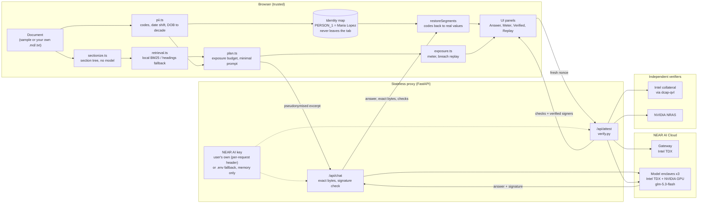

# Need-to-Know

**Ask AI about a confidential document, and send it only what it needs.**

> The TEE proves *where* your document was processed. Need-to-Know proves *how little* of it was sent.

Built at the NEAR Hackathon for the **Privacy & Private AI** track. Inference runs on **NEAR AI Cloud** inside Intel TDX and NVIDIA confidential-computing enclaves. Every question starts with a fresh-nonce attestation, and every answer is tied to a verified enclave by its signature.

**Contents:** [Core idea](#core-idea) · [How it works](#how-it-works) · [Architecture](#architecture) · [What is verified](#what-is-verified) · [What the server keeps: nothing](#what-the-server-keeps-nothing) · [Benchmark](#benchmark-does-privacy-cost-accuracy) · [Quick start](#quick-start) · [Testing guide](#testing-guide) · [Repository map](#repository-map) · [Threat model and limits](#threat-model-and-honest-limits) · [Disclosures](#disclosures) · [License](#license)

---

## Core idea

### The problem

When you ask an AI tool about a confidential document (a medical record, a contract, a bank statement), the tool usually sends far more of that document to the model than the question needs. Long-context chat pastes everything. Typical RAG sends several large raw chunks. Every extra name, ID or diagnosis sent is one more thing that can leak.

Running the model inside a **TEE** (Trusted Execution Environment) helps. The hardware keeps the operator and the host machine from reading your data while it is processed. But a TEE cannot protect you from a bug in the software running *inside* it, and it does nothing about *how much* you send.

This is not hypothetical. On **9 November 2026**, NEAR AI paused cloud inference after an attacker exploited a remote-code-execution flaw in **SGLang**, the open-source inference engine running on its servers. Reports put the exposure at roughly 100 users. NEAR AI's own explanation draws the line clearly: confidential computing protects data from the operator and host, not from a vulnerability in the software running inside the enclave. Service was restored around 10 November after a fix and credential rotation. ([Crypto Briefing](https://cryptobriefing.com/near-ai-pauses-cloud-inference-unauthorized-access/), [Let's Data Science](https://letsdatascience.com/news/sglang-flaw-lets-attacker-breach-near-ai-inference-servers-fa6fb270), [Glitchwire](https://glitchwire.com/news/near-ai-halts-cloud-inference-after-unauthorized-access-to-internal-systems/))

### The answer: two layers of protection

| Layer | Question it answers | Provided by |
|---|---|---|
| TEE and attestation | Was my data processed somewhere genuine and sealed? | NEAR AI Cloud |
| Data minimisation | How much of my data was there to steal? | Need-to-Know, running in your browser |

Need-to-Know **assumes the enclave can be breached** and keeps the blast radius small. It also measures that blast radius and proves it. Had a session like this been running during the November 9 incident, the attacker would have got only what the Breach Replay shows: a few pseudonymised sections, with no names, no IDs and no real dates.

### Key terms

| Term | Meaning here |
|---|---|
| **TEE** | Sealed hardware (Intel TDX for the CPU, NVIDIA confidential computing for the GPU) that the operator cannot look inside while it runs. |
| **Attestation** | A hardware-signed report saying "this is a genuine enclave running this exact software". |
| **Nonce** | 32 random bytes generated in your browser and embedded in the attestation, proving the report is fresh and not replayed. |
| **Pseudonymisation** | Replacing identifiers with consistent codes (`Maria Lopez` becomes `PERSON_1`). Unlike anonymisation, it can be reversed, but only by whoever holds the map, which is you. |
| **Date shifting** | Every date and month name is moved by the same secret number of whole months, so the model can still reason about intervals without learning the real calendar. |
| **Exposure budget** | The maximum share of the document allowed to leave the browser for one question. |
| **Exposure receipt** | The enclave signs `model:sha256(request):sha256(response)`. Re-hash the replayed request bytes and you can prove exactly what the enclave received. |
| **Breach Replay** | The attacker's view: exactly what someone who compromised the enclave would see for this question. |

---

## How it works

One question, end to end (medical record: "What was the patient prescribed after surgery?"):

| Step | Where | What happens |
|---|---|---|
| 1. Read | Browser | The document is split into sections using its headings. No model is involved. |
| 2. Detect PII | Browser | Names, record numbers, phones, emails, addresses, insurers and accounts become consistent codes. Dates and month names shift by a secret number of whole months. Date of birth becomes its decade. The code map stays in the browser tab. |
| 3. Attest | Browser, proxy, NEAR AI | The browser makes a fresh 32-byte nonce. The proxy verifies the gateway and every GPU enclave (see [What is verified](#what-is-verified)). **If any check fails, nothing about the document is sent.** |
| 4. Choose sections | Browser | Local BM25 keyword ranking picks the relevant sections, with no network call. Vague questions ("audit my spending") fall back to sending only the pseudonymised headings to the TEE so the model can choose. |
| 5. Apply the budget | Browser | Sections are capped at your exposure budget (10% by default). If relevant sections are cut, the app lists them and offers "Allow N% and re-ask". |
| 6. Send | Proxy to TEE | Only the pseudonymised excerpt goes to `z-ai/glm-5.3-flash` in the enclave. The proxy serialises the request once and forwards those exact bytes. |
| 7. Verify the answer | Proxy and browser | The enclave's signature must cover `sha256(request):sha256(response)` and come from an enclave verified in step 3. The browser re-hashes the request bytes with WebCrypto and finds that hash inside the signed text. |
| 8. Restore | Browser | `PERSON_1` becomes "Maria Lopez" and dates shift back. Only you see real values. |
| 9. Show the evidence | Browser | Redaction map, Exposure Meter, Verified panel, Breach Replay, benchmark. |

---

## Architecture

An editable whiteboard version is in [`docs/architecture.excalidraw`](docs/architecture.excalidraw). Open it at [excalidraw.com](https://excalidraw.com) using **Open**, or with the Excalidraw VS Code extension.

### How the parts are linked



### What happens on one question


---

## What is verified

All checks follow the [NEAR AI Cloud verification docs](https://docs.near.ai/cloud/verification). They run **before** the completion, using a nonce generated in the browser.

| Evidence | Check |
|---|---|
| Gateway and each model enclave | Intel TDX quote verified against Intel collateral (`dcap-qvl`), TCB status |
| | `request_nonce` echoed, and the nonce bound in the verified quote `report_data[32:64]` |
| | Signing address bound in `report_data[0:32]` |
| | `MRCONFIGID == 01 + sha256(app_compose) + zero padding`, which pins the exact docker compose that runs |
| | `RTMR3` equals a replay of the event log, with digests recomputed from the event fields |
| Model enclaves (GPU) | NVIDIA evidence carries our nonce, and the NVIDIA NRAS verdict is `true` |
| Each response | Signature kind is `provider_tee`, and the signed text equals `model:sha256(exact request bytes):sha256(exact response bytes)` |
| | The EIP-191 signature recovers the signing address |
| | The signer is one of the enclaves verified in the preflight. A report fetched after the completion is never accepted. |

Only models with `owned_by: "nearai"` are offered. NEAR AI hosts these in TEEs; they are not proxied third-party APIs.

---

## What the server keeps: nothing

`server/app.py` is a **stateless proxy**, and the file opens with a banner saying so.

- No database, no files written and no caches of user data. The server code contains no `open(` or `write` calls.
- The uvicorn access log is **off** (`server/main.py`). Request and response bodies are never logged and are dropped when the response returns.
- The NEAR AI key comes from one of two places, and neither is stored:
  - **Your own key** (bring-your-own-key): saved only in your browser's localStorage, sent in an `X-NearAI-Key` header with each request, used as a local variable for that one upstream call, then dropped. Never logged, cached or written.
  - **The server's key** from `.env`, held in memory. Optional: without it, every visitor brings their own.
- The pseudonym-to-identity map is created and kept **in the browser** and never reaches the server.
- The verified-signer list from `/api/attest` is sent back by the browser with each `/api/chat` call, so the server never has to remember a session.

Why have a server at all? The track requires the API key in `.env`, and Intel and NVIDIA quote verification needs native libraries. Every check result is returned to the browser, and the request bytes can be re-hashed there.

---

## Benchmark: does privacy cost accuracy?

20 questions over 3 fictional documents, run through the same pipeline code as the app (`web/bench/run_bench.ts`) against the live TEE model `z-ai/glm-5.3-flash`. Scoring is deterministic: the answer must contain an expected keyword. The run was repeated and gave identical results.

| Mode | Share of document sent | Correct | Real identifiers sent (avg) |
|---|---|---|---|
| Whole document (raw) | 100.0% | 20/20 | 21.5 |
| Typical RAG (raw 250-token chunks, top 4) | 69.3% | 20/20 | 15.3 |
| Need-to-Know, local routing, 5% budget | 5.0% | 18/20 | **0** |
| **Need-to-Know, local routing, 10% budget** | **8.0%** | **20/20** | **0** |
| Need-to-Know, local routing, 20% budget | 15.9% | 20/20 | 0 |
| Need-to-Know, heading routing, 12% budget | 14.4% | 17/20 | 0 |

**Same accuracy as pasting the whole document, with about 12 times less data and no real identifiers.** Every response in the run was signature-verified against a preflight-attested enclave. Local routing beat heading routing on these questions, so local routing is the default.

---

## Quick start

Requirements: Python 3.12 with [uv](https://docs.astral.sh/uv/), Node 20 or newer, and a NEAR AI Cloud API key (get one at [cloud.near.ai](https://cloud.near.ai), or claim $10 free via [NEAR Builders](https://nearbuilders.org/join)).

| Do | See |
|---|---|
| `cp .env.example .env`, then put your key after `API_KEY=` (optional, see the last row) | `.env` exists (it is git-ignored) |
| `cd poc && uv run python verify_once.py` | Ends with `VERIFIED: YES (35/35 checks)` |
| `cd server && uv run python main.py` | Proxy on port 8000. `curl localhost:8000/api/health` returns `{"ok":true,"stateless":true}` |
| `cd web && npm install && npm run dev` | App on http://localhost:5173 |
| Open http://localhost:5173 and click a preset question | Answer, Exposure Meter, Verified panel (all checks ticked), Breach Replay |
| `cd web && npm run bench` (proxy running) | Prints the benchmark table and rewrites `web/public/bench.json` |
| `cd web && npm run build`, then restart the proxy | The proxy also serves the built app at http://localhost:8000 |
| No `.env` key? Click **API key** in the top bar and paste your own | The status line says "Running on your own NEAR AI key", and the key stays in your browser only |

All sample documents are **fictional** (`web/public/samples/`), so no real data is needed.

### Output of `poc/verify_once.py`

```
Models listed: 64  |  NEAR-hosted TEE models: 12  |  using: z-ai/glm-5.3-flash
Fresh nonce: 8025739401f6...
> gateway   [ok] Intel TDX quote (UpToDate)  [ok] nonce bound  [ok] signer bound  [ok] MRCONFIGID  [ok] RTMR3 replay
> model x3  [ok] same five checks  [ok] GPU evidence uses our nonce  [ok] NVIDIA NRAS verdict=True
> completion  "PERSON_1 was prescribed amoxicillin 500mg, three times daily for 7 days."
> response signature
   [ok] signature_kind recognised: provider_tee
   [ok] Signed text == sha256(request):sha256(response)
   [ok] EIP-191 signature recovers signing_address
   [ok] Signer matches a preflight-verified attestation
  VERIFIED: YES   (35/35 checks)
```

---

## Testing guide

Start the proxy and the web app as in [Quick start](#quick-start), then open http://localhost:5173. Each test lists what to do and what you should see. Times are from local runs.

### A. First load (no network calls to the model yet)

| # | Do | Expect |
|---|---|---|
| A1 | Load the page | White drafting-paper grid, navy ink, cards with a crisp navy border and offset shadow. Only two colours. Headings in Inter, handwritten notes in Indie Flower. |
| A2 | Look at step 1 | Three polaroid cards (Medical record selected) and a "bring your own" card |
| A3 | In the document card, click **Your view** | Full text, with every detected identifier dotted-underlined. Hover one to see the code it leaves as (for example `PERSON_1`). The legend counts 29 identifiers for the medical record. |
| A4 | Click **What the enclave saw** | Everything is faded redaction bars, with the note "nothing has left your browser yet" |

### B. The main demo question (medical record)

| # | Do | Expect |
|---|---|---|
| B1 | Click the preset "What was the patient prescribed after surgery, and for how long?" | A progress row: verify enclave, choose sections locally, send minimal excerpt, restore names. Takes about 10 seconds. |
| B2 | Read the **Answer** card | Ciprofloxacin 500 mg twice daily for 5 days, with the penicillin allergy as the reason, citing §4.2. "Maria Lopez" is dashed-underlined (restored locally). |
| B3 | Click "show what the enclave actually answered" | The raw answer uses `PERSON_1`, never the real name |
| B4 | Look at the document (enclave view) | Scrolled to §4.2 with a "sent" margin note. Only §4.2 is readable, with `PERSON_1` tags. Every other section is a solid redaction bar. |
| B5 | **Exposure Meter** | About "9% of the document and 0 real identifiers". Whole document: 100%, 29 identifiers. Typical RAG: more than half the document and most of the identifiers. A dashed budget marker at 10%. |
| B6 | **Verified** panel | Stamp shows a tick and 35/35. Groups: Gateway, Model enclaves (GPU TEE), Response signature. Nonce, model, signer address and attestation time at the bottom. |

### C. Breach Replay and the exposure receipt

| # | Do | Expect |
|---|---|---|
| C1 | Scroll to **3 Breach replay** | Three mini pages. Whole document and typical RAG are mostly dark lines with dots marking identifiers, and list real names crossed out. Need-to-Know is mostly blank, shows 0, and says only placeholders were sent. |
| C2 | Read the payload box | The exact JSON request the enclave received. Search it for "Maria" and there are no matches; you will find `PERSON_1`. |
| C3 | Read the hash lines | "sha256 computed in your browser" plus the enclave-signed text, followed by "these exact bytes are what the attested enclave signed for" |
| C4 | Optional: save the payload text to a file with no trailing newline and run `sha256sum` on it | The same hash as the one computed in the browser and found in the signed text |

### D. Expense audit, budget and fallback routing (bank statement)

| # | Do | Expect |
|---|---|---|
| D1 | Pick **Bank statement**, click "Audit my spending: categorise it and flag anything unusual." | BM25 finds no keyword match, so it falls back to heading routing. Breach Replay gets two tabs: "1 · headings" and "2 · answer". |
| D2 | Read the dashed note under the progress row | "N more relevant sections (§3.3, ...) didn't fit your 10% budget", with an "Allow X% and re-ask" button |
| D3 | Click **Allow X% and re-ask** | A second run with the larger budget. The meter shows a large share (about 75 to 85%) and still **0 real identifiers**. |
| D4 | Read the audit | Spending by category, plus flags such as the duplicate CloudVault charge on 14/09/2026 and the OctoGrid energy jump from £96.15 to £212.60. Dates and month names come back unshifted. |
| D5 | Try "Where were the unusual night-time ATM withdrawals made?" | Lisbon, at 03:47 and 03:52, with §4.6 the only section sent |

### E. Controls and edge cases

| # | Do | Expect |
|---|---|---|
| E1 | Set the budget slider to 2% and ask a preset | The best section is sent anyway, and a handwritten note says it is over budget |
| E2 | Switch routing to **headings to TEE** | Two signed requests per question (headings, then answer); the meter splits sections and headings |
| E3 | **Employment contract**: "How long does the non-compete last, and how far does it reach?" | 6 months, 25 miles of Bristol, §6.1 |
| E4 | Upload your own `.md` or `.txt` with `## 1. Heading` style headings and a line like `Name: Jane Doe` | It is read locally and sectioned, and `Jane Doe` becomes `PERSON_1` in the enclave view |
| E5 | Stop the proxy and ask a question | A dashed error note. Nothing is sent. |
| E6 | Narrow the window to phone width | Single column, no horizontal scrolling |

### F. Server keeps nothing

| # | Do | Expect |
|---|---|---|
| F1 | `grep -nE "open\(\|write" server/*.py` | No matches |
| F2 | `touch /tmp/m`, ask three questions, then `find . -newer /tmp/m -type f -not -path "*/node_modules/*" -not -path "*/.venv/*"` | No new files |
| F3 | Watch the proxy terminal while asking | No request lines or bodies are printed |

### G. Bring your own NEAR AI key

| # | Do | Expect |
|---|---|---|
| G1 | Click **API key** in the top bar | A dialog explains the key is stored only in this browser, sent per request in a header and never stored by the server, with links to get a key |
| G2 | Paste a valid key and click **Save key** | The top bar shows a filled dot and "Your key". The line under the controls says "Running on your own NEAR AI key (ending ....)". |
| G3 | Ask a preset | Works as before (35/35). In DevTools, Network, `/api/chat`, the request has an `X-NearAI-Key` header. |
| G4 | Save an invalid key such as `sk-test`, then ask | A 401 note: "NEAR AI rejected the key", and the dialog reopens. Your own key always takes priority over the server key. |
| G5 | Click **Remove my key** | Back to "Running on the demo server's key", or "No key yet" when the server has none |
| G6 | Run the proxy without `.env` and open the app | The line says "No key yet". Asking opens the key dialog instead of failing. |

---

## Repository map

| Path | What it is |
|---|---|
| `poc/verify_once.py` | Minimal, self-contained script: one completion plus full verification |
| `server/verify.py` | Attestation and signature verification (TDX, nonce, signer, MRCONFIGID, RTMR3, NRAS, EIP-191) |
| `server/app.py` | Stateless proxy: `/api/models`, `/api/attest`, `/api/chat` |
| `web/src/lib/sectionize.ts` | Local section tree (no model) |
| `web/src/lib/pii.ts` | Local PII detection, consistent pseudonyms, month-level date shifting, restoration |
| `web/src/lib/retrieval.ts` | BM25 routing, heading-routing prompt, typical-RAG baseline |
| `web/src/lib/plan.ts` | Exposure budget and minimal prompt |
| `web/src/lib/exposure.ts` | Exposure accounting for the three approaches, measured on real request bytes |
| `web/src/lib/api.ts` | Proxy client, nonce generation, in-browser SHA-256 |
| `web/src/components/` | UI: document redaction map, answer, meter, verified panel, breach replay, explainer, benchmark chart |
| `web/bench/run_bench.ts` | Accuracy-vs-exposure benchmark |
| `web/public/samples/` | Fictional documents and question presets |
| `docs/architecture.excalidraw` | Editable architecture diagram |

---

## Threat model and honest limits

- **In scope:** a compromised or curious inference enclave, operator or log pipeline, as in the November 9 incident. They see only the minimal, pseudonymised excerpt, which is the Breach Replay view.
- **Same operator:** NEAR AI runs all the enclaves. Splitting a request across independent operators is future work.
- **Where verification runs:** quote verification runs in our proxy because it needs native libraries. Request hashing and the comparison with the signature run in the browser. Moving the full verifier into the browser (WASM) is future work.
- **Detector recall:** PII detection uses regular expressions, labelled fields and a name list, so it can miss unusual identifiers. The Exposure Meter scans the actual bytes sent, but only for identifiers the detector found.
- **Content can still identify:** pseudonymisation hides identities, not facts. A rare diagnosis combined with a shifted date could still narrow down a person. Minimisation keeps that combined exposure small, and the budget makes it a choice the user sees.
- **Your own key in the browser:** a key in localStorage can be read by any script running on the page. The app loads no third-party scripts (only Google Fonts CSS), but a key with a small balance is still the safer choice.
- **Signature guarantees:** per NEAR's docs, a `provider_tee` signature proves the response came from a model enclave holding that key. Instances of the same model share a key.

---

## Disclosures

Made in line with the hackathon rules (Q-002, Q-003, Q-005).

- **New work:** everything in this repository was written during the hackathon window. No earlier project is reused. An earlier personal project (PrivateRAG, a different repository) explored vectorless RAG on NEAR AI. It inspired the idea, but none of its code is included here.
- **AI assistance:** large parts of the code and documentation were written with an AI coding assistant (Claude Code), directed, reviewed and tested by the author.
- **Template:** `web/` started from the official Vite `react-ts` template.
- **Reference code:** the verification logic follows NEAR's docs and the public [nearai-cloud-verifier](https://github.com/nearai/nearai-cloud-verifier) reference. It is re-implemented, with preflight-first ordering and RTMR3 replay with recomputed digests.
- **Libraries:** Python: FastAPI, Uvicorn, Requests, `dcap-qvl` (Intel quote verification), `eth-account` (signature recovery). Web: React, Vite, TypeScript. Bench: `tsx`. Fonts: Inter and Indie Flower from Google Fonts.
- **Other chains:** none. The NEAR integration (NEAR AI Cloud private inference and its attestation) is the only blockchain-ecosystem integration.

---

## License

[MIT](LICENSE)

## Data

All documents in `web/public/samples/` are **fictional**, generated for this demo. Every person, number, address and merchant is invented.
