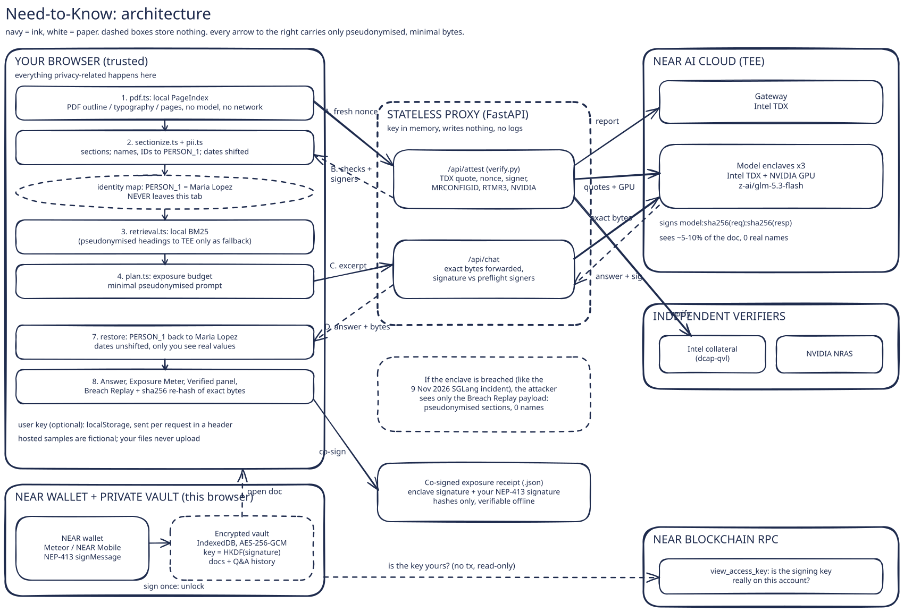
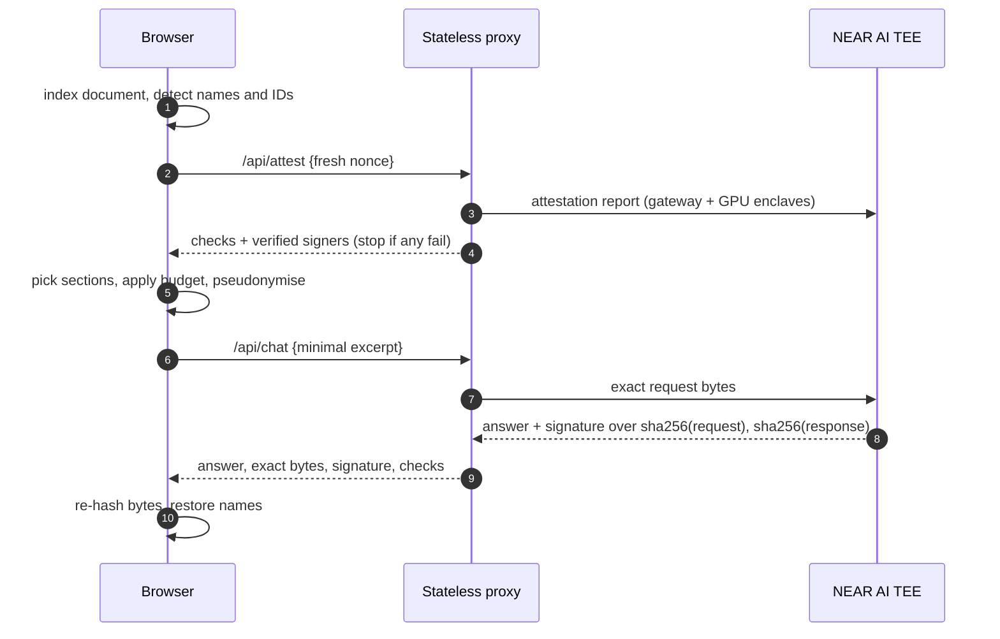

# Need-to-Know

**Ask AI about a confidential document, and send it only what it needs.**

> The TEE proves *where* your document was processed. Need-to-Know proves *how little* of it was sent.

**Demo video:** [watch on X](https://x.com/vg_jojo239/status/2121713826701922330)

Need-to-Know is a private document Q&A app built on **NEAR AI Cloud**. Inference runs inside Intel TDX + NVIDIA confidential-computing enclaves, and every question starts with a fresh-nonce attestation, so nothing is sent until the enclave is verified. Documents are indexed, minimised and pseudonymised in your browser: the model receives only the few sections a question needs, with names and IDs replaced by codes, and the answer is restored locally. The enclave signs the exact bytes it received, so you can see and prove what left your machine. A NEAR wallet co-signs these exposure receipts and unlocks an encrypted vault for your documents that never leaves your browser.

**Why it matters:** on 9 November 2026 NEAR AI paused inference after an RCE in SGLang, the engine running *inside* its enclaves ([report](https://cryptobriefing.com/near-ai-pauses-cloud-inference-unauthorized-access/)). A TEE protects data from the operator and host, but not from a bug in the software running inside it, and AI tools usually send far more of a document than a question needs. Need-to-Know assumes the enclave can be breached and keeps what is there to steal **small, coded and provable**: in our benchmark, about 8% of the document and zero real identifiers (counted in the exact bytes sent, for every identifier the browser detects), with the same accuracy as sending everything.

---

## User flow

1. **Pick a document:** a fictional sample, or your own PDF / Markdown / text. It is indexed in the browser; nothing is uploaded.
2. **Optional:** connect a NEAR wallet (Meteor or NEAR Mobile) and unlock your encrypted vault with one signature.
3. **Ask.** The enclave is verified first, then only the relevant, coded sections are sent. Names come back restored.
4. **See the proof:** what the enclave saw, the Exposure Meter, 35/35 checks, and **Breach Replay** with the exact bytes and their hash inside the enclave's signature.
5. **Optional:** co-sign the receipt with your wallet. Come back later and your documents and Q&A are still in your vault.

## Architecture



## How it works



| Step | Code | What happens |
|---|---|---|
| Index locally | `web/src/lib/pdf.ts`, `sectionize.ts` | Sections from the PDF outline, else typography, else pages. No model, no network. |
| Pseudonymise | `pii.ts` | Names, IDs, phones, emails, addresses become codes (`Maria Lopez` → `PERSON_1`). Dates shift by a secret offset. The map stays in the browser. |
| Pick sections | `retrieval.ts`, `plan.ts` | Local BM25 under an exposure budget (default 10%). Cut sections are named, with one-click re-ask. |
| Verify first | `server/verify.py` | Fresh browser nonce; full Intel TDX + NVIDIA verification. If anything fails, nothing is sent. |
| Exact bytes | `server/app.py` | The request is serialised once; the enclave signs `sha256(request)` and `sha256(response)`; the browser re-hashes and matches. |
| Wallet + vault | `near.ts`, `vault.ts`, `receipt.ts` | NEP-413 signatures verified locally and on-chain. One signature derives an AES-256-GCM key for a vault stored only in this browser. Receipts hold hashes only. |

## What is verified

Before anything about the document is sent, for the gateway and each GPU enclave:

- the Intel TDX quote is verified against Intel's collateral (`dcap-qvl`)
- our fresh nonce is bound inside the quote (`report_data[32:64]`), next to the enclave's signing address (`report_data[0:32]`)
- `MRCONFIGID` equals the hash of the exact docker compose the enclave runs
- `RTMR3` matches a replay of the enclave's event log
- NVIDIA's attestation service (NRAS) approves the GPU evidence, which carries our nonce

After the answer:

- the enclave's `provider_tee` signature covers `sha256(exact request)` and `sha256(exact response)`
- the signature recovers (EIP-191) to an enclave that was verified *before* the call
- the browser re-hashes the request bytes it shows you and finds that hash in the signed text

Only NEAR-hosted TEE models (`owned_by: "nearai"`) are offered. The app uses `z-ai/glm-5.3-flash`.

## What the server keeps: nothing

`server/app.py` is a stateless proxy, and a banner at the top of the file says so.

- No database, no files written, no caches. The server code has no `open(` or `write` calls.
- The uvicorn access log is off; request and response bodies are never logged.
- The NEAR AI key is either yours (sent per request in a header, then dropped) or the server's from `.env`.
- The name map, the vault and the vault key exist only in your browser.

A server is needed only because Intel and NVIDIA quote verification uses native libraries. Every check result and the exact request bytes come back to the browser, which re-hashes them itself.

## Built on NEAR

- **NEAR AI Cloud inference:** the OpenAI-compatible `/v1/chat/completions` API on a TEE model
- **NEAR AI attestation:** `/v1/attestation/report` with our nonce, for the gateway and every GPU enclave
- **NEAR AI response signatures:** `/v1/signature/{id}`, checked against the attested signer
- **NEAR wallet (NEP-413):** Meteor or NEAR Mobile signs exposure receipts and unlocks the vault; signatures are verified in the browser
- **NEAR RPC:** `view_access_key` confirms the signing key belongs to the account

## Benchmark

| Mode | Sent | Correct | Real identifiers |
|---|---|---|---|
| Whole document | 100% | 20/20 | 21.5 |
| Typical RAG | 69.3% | 20/20 | 15.3 |
| **Need-to-Know** | **8.0%** | **20/20** | **0** |

20 questions over the three fictional sample documents, run through the same code as the app (`web/bench/run_bench.ts`, `npm run bench`) against the live TEE model. An answer counts as correct if it contains the expected keyword, and every response was signature-verified against an attested enclave. *Typical RAG* means raw ~250-token chunks, top 4 by BM25, no redaction. Identifiers are counted in the exact request bytes, for every identifier the browser detects.

---

## Run it

Python 3.12 + [uv](https://docs.astral.sh/uv/), Node 20+, and a NEAR AI Cloud key from [cloud.near.ai](https://cloud.near.ai) ($10 of free credit via [NEAR Builders](https://nearbuilders.org/dashboard)).

```bash
cp .env.example .env                        # replace the placeholder with API_KEY=<your key>
cd poc && uv run python verify_once.py      # VERIFIED: YES (35/35 checks)
cd ../server && uv run python main.py       # proxy on :8000 (keeps running)
```

In a second terminal:

```bash
cd web && npm install && npm run dev        # app on http://localhost:5173
```

No key in `.env`? Tick **Use my own NEAR AI key** in the app instead; it stays in your browser.

## End-to-end test flow

With the proxy and app running ([Run it](#run-it)):

1. **Attestation script.** Run `cd poc && uv run python verify_once.py`.
   Expect `VERIFIED: YES (35/35 checks)`.
2. **Ask about a sample.** Open http://localhost:5173, pick **Medical record**, click *"What was the patient prescribed after surgery, and for how long?"*.
   Expect ciprofloxacin 500 mg twice daily for 5 days, about 9% of the document sent, 0 real identifiers, and 35/35 in the **Verified** panel.
3. **Check the proof.** Scroll to **Breach replay**.
   Expect the request to contain `PERSON_1`, never the patient's name, and *"these exact bytes are what the attested enclave signed for"*.
4. **Use a real PDF.** Upload [arXiv 1706.03762](https://arxiv.org/pdf/1706.03762v7) and ask *"What BLEU score did the big Transformer reach on English-to-German?"*.
   Expect the index built from the PDF outline, the answer 28.4, about 9% sent and no author names.
5. **Wallet and vault** (optional, needs a mainnet NEAR wallet). Connect Meteor, click **Unlock vault**, **Save** the document, ask, then **Co-sign with NEAR**.
   Expect the signature verified in the browser, the key confirmed on-chain, and a downloadable receipt.
6. **Come back** (optional). Reload and unlock again.
   Expect the same vault with your document and earlier Q&A.

## Limits

- NEAR AI runs every enclave; splitting across operators is future work.
- PII detection is rule-based and can miss unusual identifiers; keyword routing can pick the wrong section (re-ask is offered).
- Pseudonymisation hides identities, not facts.

## Disclosures

Coding was done using [Claude Code](https://claude.com/claude-code).

- **Libraries:** FastAPI, Uvicorn, Requests, `dcap-qvl`, `eth-account` (server and script); React, pdf.js, `@near-wallet-selector` (core, modal-ui, meteor-wallet, near-mobile-wallet), `@noble/curves`, `@noble/hashes`, `buffer` (web); `tsx` (benchmark).
- **Template:** `web/` started from the official Vite `react-ts` template.
- **Fonts:** Inter and Indie Flower (Google Fonts).

## License

[MIT](LICENSE). All bundled sample documents are fictional.
