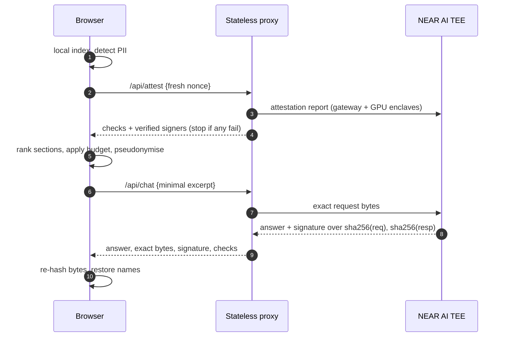

# Need-to-Know

**Ask AI about a confidential document, and send it only what it needs.**

> The TEE proves *where* your document was processed. Need-to-Know proves *how little* of it was sent.

NEAR Hackathon, **Privacy & Private AI** track. Inference runs on **NEAR AI Cloud** in Intel TDX + NVIDIA confidential-computing enclaves, verified with a fresh nonce before every question. Documents are indexed, minimised and pseudonymised in the browser. A NEAR wallet co-signs receipts and unlocks an encrypted vault that never leaves your machine.

**Why it matters:** on 9 November 2026 NEAR AI paused inference after an RCE in SGLang, the engine running *inside* its enclaves ([report](https://cryptobriefing.com/near-ai-pauses-cloud-inference-unauthorized-access/)). A TEE protects data from the operator, not from a bug inside it. Need-to-Know assumes the enclave can be breached and keeps what is there to steal small, coded and provable.

---

## User flow

1. **Open the app.** Optionally tick **Use my own NEAR AI key** (stored only in your browser).
2. **Pick a document:** a fictional sample, or your own PDF / Markdown / text. It is indexed locally ("Local index: N sections, 0 bytes sent").
3. **Optional: Connect NEAR** (Meteor or NEAR Mobile) and **Unlock vault** with one signature. Save the document to your encrypted vault.
4. **Ask.** The app attests the enclave, picks the few relevant sections, swaps identifiers for codes (`Maria Lopez` becomes `PERSON_1`), sends that sliver and restores names in the answer.
5. **Check the evidence:** redaction map of what the enclave saw, **Exposure Meter** (vs. whole document and typical RAG), **Verified** panel (35 checks).
6. **Breach Replay:** the attacker's copy, as exact request bytes. Your browser re-hashes them and finds the hash inside the enclave's signature.
7. **Co-sign** the receipt with your wallet and download it (hashes only).
8. **Come back later:** unlock the vault, reopen the document and its earlier Q&A.

---

## Architecture


Editable source: [`docs/architecture.excalidraw`](docs/architecture.excalidraw) (open at [excalidraw.com](https://excalidraw.com)).



---

## How it works

| Step | Where | What happens |
|---|---|---|
| Local PageIndex | `web/src/lib/pdf.ts`, `sectionize.ts` | pdf.js in the browser. Sections come from the PDF outline, else typography (size, bold, `3.2.1` numbering), else pages. No model, no network. |
| Pseudonymise | `pii.ts` | Names, IDs, phones, emails, addresses, orgs, accounts become consistent codes. Dates shift by a secret number of months; DOB becomes its decade. The map stays in the browser. |
| Choose sections | `retrieval.ts` | Local BM25. Vague questions fall back to sending only pseudonymised headings so the model can pick. |
| Exposure budget | `plan.ts` | Default 10%. Relevant sections that were cut are named, with a one-click **Allow N% and re-ask**. |
| Attest first | `server/verify.py` | Browser nonce, full TDX + NVIDIA verification. If any check fails, nothing is sent. |
| Exact bytes | `server/app.py` | The body is serialised once; those bytes are sent, hashed and shown. The enclave signs `model:sha256(req):sha256(resp)`. |
| Wallet | `near.ts`, `nep413.ts` | Meteor or NEAR Mobile. NEP-413 signatures are verified locally (ed25519), and the key is checked on-chain (`view_access_key`). |
| Private vault | `vault.ts` | Wallet signature → HKDF → AES-256-GCM key (memory only). Documents and Q&A history encrypted in IndexedDB, in this browser only. |
| Receipt | `receipt.ts` | Your NEP-413 signature over model, nonce, request/response hashes, exposure % and identifiers sent. No document text. |
| Own key | `api.ts`, `KeyDialog.tsx` | localStorage, sent per request as `X-NearAI-Key`, used once and dropped. |

### What is verified
- **Gateway and each GPU enclave:** Intel TDX quote (`dcap-qvl`), our nonce in `report_data[32:64]`, signer in `report_data[0:32]`, `MRCONFIGID == sha256(app_compose)`, RTMR3 event-log replay, NVIDIA NRAS verdict with our nonce.
- **Each response:** `provider_tee` signature over `model:sha256(exact request):sha256(exact response)`, EIP-191 recovery, signer must be an enclave verified *before* the call.
- **Browser:** request hash found in the signed text; wallet signatures and on-chain keys.
- Only `owned_by: "nearai"` models (hosted in TEEs) are offered. The app uses `z-ai/glm-5.3-flash`.

### What the server keeps: nothing
`server/app.py` is a stateless proxy (see the banner at the top of the file): no database, no files, no `open(`/`write` calls, uvicorn access log off, bodies never logged. The identity map, vault and vault key exist only in the browser.

### Benchmark
20 questions, 3 fictional documents, live TEE model (`npm run bench`):

| Mode | Sent | Correct | Real identifiers |
|---|---|---|---|
| Whole document | 100% | 20/20 | 21.5 |
| Typical RAG (top 4 chunks) | 69.3% | 20/20 | 15.3 |
| **Need-to-Know (10% budget)** | **8.0%** | **20/20** | **0** |

---

## Quick start

Python 3.12 + [uv](https://docs.astral.sh/uv/), Node 20+, a NEAR AI Cloud key ([cloud.near.ai](https://cloud.near.ai)).

```bash
cp .env.example .env                        # API_KEY=... (optional if you paste your own key in the app)
cd poc && uv run python verify_once.py      # VERIFIED: YES (35/35 checks)
cd ../server && uv run python main.py       # proxy on :8000
cd ../web && npm install && npm run dev     # app on http://localhost:5173
```

`npm run build` makes the proxy serve the app on :8000. `VITE_NEAR_NETWORK=testnet` switches the wallet network.

---

## End-to-end test flow

All results below were observed against the live TEE model.

| # | Do | Expect |
|---|---|---|
| 1 | `cd poc && uv run python verify_once.py` | `VERIFIED: YES (35/35 checks)` |
| 2 | Open the app, **Medical record**, click **Your view** | "Local index: 30 sections"; 29 identifiers underlined |
| 3 | Ask "What was the patient prescribed after surgery, and for how long?" | Ciprofloxacin 500 mg twice daily for 5 days. Meter: ~9% sent, **0 identifiers**. Stamp 35/35 |
| 4 | **Breach replay**, search the payload for "Maria" | No match, only `PERSON_1`. "these exact bytes are what the attested enclave signed for" |
| 5 | **Bank statement**, "Audit my spending..." | Heading routing; dashed note offers **Allow N% and re-ask**; re-ask still 0 identifiers |
| 6 | Upload a real PDF: `curl -L -o attention.pdf https://arxiv.org/pdf/1706.03762v7`, ask "What BLEU score did the big Transformer reach on English-to-German?" | 22 sections from the PDF outline. 28.4, 9.4% sent, 0 of 8 author names |
| 7 | Tick **Use my own NEAR AI key**, paste a key, ask | Works; `/api/chat` carries `X-NearAI-Key`. An invalid key gives a clear 401 |
| 8 | **Connect NEAR** → Meteor (extension, or web wallet: *Import an existing wallet* → secret phrase) → Connect | Top bar shows your account |
| 9 | **Unlock vault (sign once)** → approve "Sign Message" | Vault opens. **Save** the document |
| 10 | Ask a question | Vault entry shows "1 question" |
| 11 | Breach replay → **Co-sign with NEAR** → approve | "signature verified in your browser" and "full-access key of you.near on-chain". **Download receipt** |
| 12 | Reload, unlock again, open the document | Same key re-derived; earlier Q&A restored. IndexedDB holds only ciphertext |
| 13 | Disconnect | Vault locks |
| 14 | `touch /tmp/m`, ask 3 questions, `find . -newer /tmp/m -type f -not -path "*/node_modules/*" -not -path "*/.venv/*"` | No new files |

Steps 8 to 13 were run with a real mainnet account through the real Meteor web wallet (no mocks), and the downloaded receipt was verified offline (ed25519 + EIP-191).

**NEAR Mobile:** choose it in the wallet modal and scan the QR code with the app. Its first sign-in adds a login key on-chain, so the account needs a little NEAR for gas. Message signing itself is free.

---

## Limits

- NEAR AI runs every enclave; splitting across operators is future work.
- PII detection is rule-based and can miss unusual identifiers. Keyword routing can pick the wrong section; the model is told to say so, and re-ask is offered.
- Pseudonymisation hides identities, not facts. Minimisation keeps that small.
- A key in localStorage is readable by scripts on the page; the app loads none from third parties. Use a low-balance key.

## Disclosures

- New work written during the hackathon. Adapted from the author's earlier **PrivateRAG**: the wallet-selector pattern and the "key from a wallet signature" vault idea. Changed here: local NEP-413 verification, on-chain key check, HKDF, browser-only vault, and a local PageIndex instead of an LLM-built one.
- Written with an AI coding assistant (Claude Code), directed, reviewed and tested by the author. `web/` started from the Vite `react-ts` template. Verification follows NEAR's docs and [nearai-cloud-verifier](https://github.com/nearai/nearai-cloud-verifier).
- Libraries: FastAPI, Uvicorn, Requests, `dcap-qvl`, `eth-account`; React, Vite, pdf.js, `@near-wallet-selector` (core, modal-ui, meteor-wallet, near-mobile-wallet), `@noble/curves`, `@noble/hashes`. No other chains.

## License and data

[MIT](LICENSE). Bundled samples in `web/public/samples/` are **fictional**. Public PDFs used in testing are not included.
